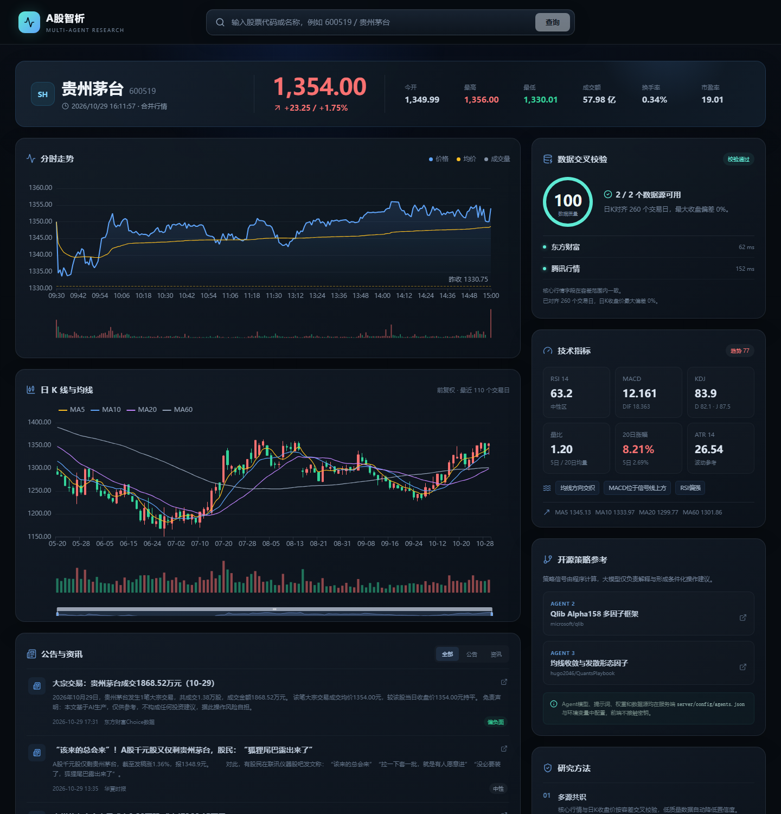
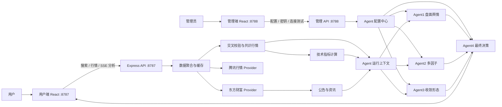

# A股智析：多 Agent 股票分析工作台

一个可直接部署到服务器的 A 股研究与辅助决策系统。用户输入股票代码或名称后，系统会聚合行情、分时、日 K、技术指标、公告和资讯，通过多个独立 Agent 生成分析，并由最终决策 Agent 汇总为条件化操作建议。



> 本项目用于量化研究、信息整理和软件工程演示，不构成投资建议，也不承诺任何收益。A 股存在价格波动、流动性、政策和突发事件风险，请独立判断并控制仓位。

## 功能概览

- 股票代码或名称搜索，支持沪深京 A 股。
- 东方财富、腾讯行情双数据源，支持最新价、昨收、开盘、最高、最低及日 K 收盘价交叉校验。
- 分时图、前复权日 K、MA、MACD、RSI、KDJ、BOLL、ATR、量比等技术指标。
- 公告与财经资讯聚合，并进行本地关键词情绪标记。
- Agent1：结合走势、技术指标、公告和资讯进行盘面舆情分析。
- Agent2：参考 Qlib Alpha158 多因子思想，生成可解释的单标的因子分析。
- Agent3：参考 QuantsPlaybook 的均线收敛与发散形态因子，识别收敛、突破和量能确认。
- Agent4：整合前三路分析、分歧、数据质量和风险，输出最终结论与条件化计划。
- 四个 Agent 的供应商、模型、API 地址、提示词、温度和策略参数均可独立配置。
- 管理端支持模型连接测试、配置校验、在线保存、权重调整和密钥管理。
- 未配置大模型时自动使用本地规则引擎，项目仍可完整运行。
- 用户端只展示研究结果，模型配置和密钥保留在后端管理端。

## 系统架构



## Agent 职责

| Agent | 主要职责 | 输入 | 输出 |
| --- | --- | --- | --- |
| Agent1 | 盘面、技术指标、公告与资讯综合分析 | 行情、指标、公告、资讯 | 市场分析、风险、操作建议 |
| Agent2 | Qlib Alpha158 风格多因子解释 | 动量、波动率、量能、技术趋势 | 多因子分析、策略建议 |
| Agent3 | 均线收敛与发散形态识别 | 价量均线、突破、量能确认 | 形态分析、策略建议 |
| Agent4 | 汇总、冲突处理与最终决策 | 前三路 Agent 结果、数据质量、权重 | 最终信号、置信度、操作计划 |

Agent2 和 Agent3 的策略得分与方向由程序计算，模型主要负责解释与生成操作表达，避免模型改写可复现的策略事实。

## 数据流转

1. 用户输入股票代码或名称，前端调用搜索接口解析证券。
2. 后端并发请求已启用的行情数据源，获取实时行情、分时、日 K、公告与资讯。
3. 系统对核心价格字段和日 K 收盘价计算共识值与相对偏差。
4. 数据校验结果生成 0-100 数据质量分，并进入所有 Agent 的上下文。
5. Agent1、Agent2、Agent3 并行运行，前端通过 SSE 实时展示阶段状态。
6. Agent4 根据配置权重、数据质量、前序结论和风险项生成最终结果。
7. 前端展示图表、技术指标、公告资讯、数据校验、开源策略参考和 Agent 结论。

## 数据准确性策略

1. 两个数据源独立获取同一只股票的最新行情。
2. 对最新价、昨收、今开、最高、最低计算共识中位数和最大相对偏差。
3. 按交易日对齐最近日 K，比较收盘价最大偏差。
4. 结合数据源可用性、字段容差和 K 线一致性生成数据质量分。
5. Agent4 使用数据质量分修正最终置信度，并明确展示偏差和缺失信息。

默认容差可在管理端调整：

- 行情容差：`marketData.quoteTolerancePct`
- 日 K 容差：`marketData.closeTolerancePct`

## 技术栈

- 前端：React 19、TypeScript、Vite、ECharts
- 后端：Node.js 20+、Express 5、Zod
- 构建：tsup、Vite、pnpm
- 数据源：东方财富、腾讯行情
- 部署：PM2、Docker、Nginx

## 目录结构

```text
admin/                    后端管理网页
web/                      用户分析网页
server/
  admin.ts                管理 API
  config.ts               配置校验与加载
  secrets.ts              后端密钥读取与保存
  providers/              行情数据源适配器
  services/
    market.ts             行情聚合、缓存与搜索
    validation.ts         双源交叉校验
    indicators.ts         技术指标计算
    strategies.ts         本地策略与规则引擎
    llm.ts                模型调用、结构化输出与连接测试
    agents.ts             四 Agent 编排
  config/agents.json      默认 Agent 配置
shared/types.ts           前后端共享类型
docs/ARCHITECTURE.md      架构说明
docs/DEPLOYMENT.md        部署说明
```

## 快速启动

要求：

- Node.js 20 或更高版本
- pnpm 9 或更高版本

安装依赖：

```bash
pnpm install
cp .env.example .env
pnpm dev
```

开发端口：

| 服务 | 地址 |
| --- | --- |
| 用户端 | http://localhost:5173 |
| 管理端 | http://localhost:5174 |
| 用户 API | http://localhost:8787 |
| 管理 API | http://localhost:8788 |

生产构建与启动：

```bash
pnpm build
pnpm start
```

生产端口：

- 用户端与公开 API：http://localhost:8787
- 后端管理控制台：http://localhost:8788

## 管理端配置

访问 `http://服务器IP:8788`，展开任意 Agent 即可独立配置：

- Agent 名称、职责和启用状态
- 模型供应商
- 模型名称
- 自定义 Base URL
- 模型 API Key
- 温度、最大输出 Tokens、超时
- 系统提示词
- Agent2 与 Agent3 的策略参数

### 模型 API Key

推荐直接在管理端填写：

1. 展开 Agent。
2. 填写供应商、模型和 Base URL。
3. 在“模型 API Key”输入框输入密钥。
4. 点击“测试连接”。
5. 测试通过后点击“保存密钥”。
6. 最后保存整体配置。

“测试连接”会验证模型是否能够返回结构化 JSON，而不仅仅是接口是否在线。测试使用当前表单中尚未保存的配置，不会写入配置或密钥。

也可以使用环境变量：

```dotenv
AGENT1_API_KEY=
AGENT2_API_KEY=
AGENT3_API_KEY=
AGENT4_API_KEY=
```

环境变量优先于管理端保存的密钥。管理端保存的密钥写入 `server/config/secrets.json`，该文件已被 Git 和 Docker 构建忽略，不会回传到浏览器。

### 结构化研判

正式分析会启用 JSON 模式，并自动保证至少 8192 tokens 的输出预算。思考型模型耗尽首次预算时会自动重试到 16384 tokens。

建议配置：

- Agent1-3：8192 tokens，90 秒超时
- Agent4：16384 tokens，180 秒超时

模型接口出现 429、500、502、503、504 或临时网络错误时，后端会自动重试。模型多返回分析条目、返回中文信号或分数轻微越界时，系统会先规范化再校验。

### 本地规则模式

发布版默认将四个 Agent 设置为 `rule` 模式，不包含任何真实模型名称、私有 Base URL 或 API Key。首次部署时无需模型即可运行。

切换模型模式时，在管理端选择供应商并填写模型信息；没有密钥或调用失败时，系统会自动降级到本地规则引擎。

支持的供应商：

`rule`、`openai`、`deepseek`、`qwen`、`moonshot`、`ollama`、`custom`

## 环境变量

复制 `.env.example` 为 `.env`：

```dotenv
NODE_ENV=production
HOST=0.0.0.0
PORT=8787
ADMIN_HOST=0.0.0.0
ADMIN_PORT=8788
ADMIN_TOKEN=replace-with-a-strong-random-token
AGENT1_API_KEY=
AGENT2_API_KEY=
AGENT3_API_KEY=
AGENT4_API_KEY=
```

生成管理令牌：

```bash
openssl rand -hex 32
```

## 主要 API

| 方法 | 路径 | 用途 |
| --- | --- | --- |
| GET | `/api/health` | 用户端健康检查 |
| GET | `/api/meta` | 数据源、Agent 和策略元数据 |
| GET | `/api/search?q=茅台` | 股票搜索 |
| GET | `/api/dashboard?q=600519` | 行情、图表、指标、公告、资讯与校验结果 |
| POST | `/api/analysis/stream` | SSE 流式运行四 Agent |
| GET | `:8788/api/health` | 管理端健康检查 |
| GET | `:8788/api/admin/session` | 管理会话验证 |
| GET | `:8788/api/admin/status` | 运行状态与密钥检测 |
| GET/PUT | `:8788/api/admin/config` | 读取或保存 Agent 配置 |
| POST | `:8788/api/admin/config/validate` | 校验配置与权重 |
| POST | `:8788/api/admin/secrets` | 保存或清除指定 Agent 的密钥 |
| POST | `:8788/api/admin/agents/:id/test` | 测试模型结构化输出，不保存配置 |

分析请求：

```json
{
  "query": "600519"
}
```

SSE 事件包括：

- `stage`：Agent 阶段状态
- `result`：完整分析结果
- `error`：流程错误

## 部署

### PM2

```bash
pnpm install --frozen-lockfile
pnpm build
pm2 start ecosystem.config.cjs
pm2 save
```

### Docker

```bash
cp .env.example .env
docker compose up -d --build
docker compose logs -f
```

Docker 会排除：

- `.env`
- `server/config/secrets.json`
- `server/config/*.bak`
- 本地截图和构建产物

### Nginx

建议：

- 用户端 `8787` 使用公网域名。
- 管理端 `8788` 使用独立域名并限制来源 IP。
- 对 `/api/analysis/stream` 关闭代理缓冲并提高读取超时。
- 生产环境必须设置 `ADMIN_TOKEN` 并使用 HTTPS。

完整部署说明见 [docs/DEPLOYMENT.md](docs/DEPLOYMENT.md)。

## 安全建议

- 不要提交 `.env`、`secrets.json`、真实 Base URL 或个人模型配置。
- 公网部署前设置强随机 `ADMIN_TOKEN`。
- 仅向可信网络开放 `8788`，优先使用 VPN 或来源 IP 白名单。
- 定期轮换模型 API Key。
- 不要将模型密钥写入提示词、README、截图或前端代码。
- 若密钥曾进入 Git 历史，应立即在供应商控制台撤销并重新生成。

## 验证

```bash
pnpm typecheck
pnpm build
```

或一次执行：

```bash
pnpm check
```

## 常见问题

### 页面能打开，但研判全部降级

1. 在管理端点击“测试连接”，确认返回“结构化 JSON 正常”。
2. 检查 Agent 的最大输出 Tokens 和超时。
3. Agent4 建议使用 16384 tokens、180 秒超时。
4. 查看前端 Agent 卡片中的 `warning` 信息。

### 管理端远程访问返回 503

服务器未配置 `ADMIN_TOKEN` 时，管理端只允许本机回环地址访问。请在 `.env` 中设置强随机管理令牌并重启服务。

### 行情源暂时不可用

系统会尝试其他已启用数据源，并在数据校验卡片中显示各数据源状态。公开行情接口可能调整字段或访问策略，生产环境应增加监控、持久化缓存和请求限流。

## 策略参考

- [microsoft/qlib](https://github.com/microsoft/qlib)：参考 Alpha158 的价量因子研究思路。
- [hugo2046/QuantsPlaybook](https://github.com/hugo2046/QuantsPlaybook)：参考均线收敛与发散形态因子。

本项目对上述方法进行了单标的适配和可解释化改造，不等同于原仓库的完整训练、横截面选股或历史回测结果。

## 免责声明

本项目仅用于软件开发、量化研究和信息整理。任何分析、评分、信号和操作计划都不构成投资建议、收益承诺或交易指令。使用者应自行核验数据，并根据风险承受能力独立决策。
