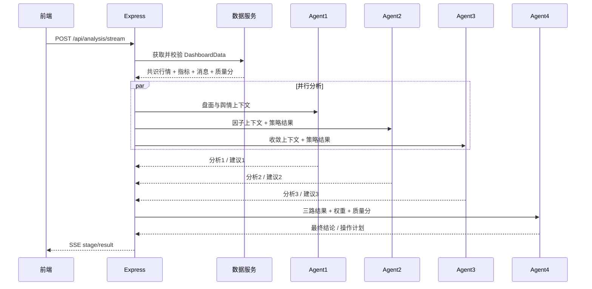

# 整体架构与数据流

## 1. 设计目标

系统将“数据可信度”和“分析可复现性”放在大模型之前：行情先经过多源校验，策略先由确定性代码计算，再由可独立配置的大模型解释和整合。这样可以避免多个 Agent 共享同一错误数据或模型幻觉后形成虚假共识。

## 2. 分层架构

```text
展示层 React + ECharts
  ├─ 股票搜索与行情工作台
  ├─ 分时、日K、技术指标、公告资讯
  ├─ 数据质量与双源状态
  └─ Agent 进度、个体结论、最终结论
管理展示层 React 管理控制台 :8788
  ├─ 数据源与校验阈值
  ├─ 四个 Agent 独立模型配置
  ├─ 融合权重与密钥环境变量状态
  └─ 服务器运行状态
          │ HTTP / SSE
API 层 Express
  ├─ /api/search
  ├─ /api/dashboard
  ├─ /api/analysis/stream
  ├─ /api/meta
  └─ /api/admin/config
          │
应用服务层
  ├─ MarketService      股票解析、双源聚合、缓存
  ├─ ValidationService  行情与日K交叉校验
  ├─ IndicatorService   MA/MACD/RSI/KDJ/BOLL/ATR
  ├─ NewsService        公告资讯与本地情绪打分
  ├─ StrategyService    三套可复现策略计算
  ├─ LlmService         OpenAI兼容模型调用与JSON校验
  └─ AgentOrchestrator  并行分析、降级、Agent4汇总
          │
基础设施层
  ├─ EastmoneyProvider
  ├─ TencentProvider
  ├─ TTL内存缓存
  └─ agents.json + 环境变量
```

## 3. 模块职责

| 模块 | 主要职责 | 关键输出 |
| --- | --- | --- |
| React 前端 | 用户搜索、图表展示、消息阅读、Agent 进度与结论展示 | 可视化工作台 |
| React 管理端 | 配置数据源、Agent 模型、提示词、参数和权重 | 后端配置网页 |
| Express API | 参数校验、SSE、管理配置鉴权、静态资源服务 | JSON / SSE |
| MarketService | 股票代码/名称解析、Provider 编排、缓存、回退 | 统一行情快照 |
| EastmoneyProvider | 名称搜索、行情、日K、分时、公告、资讯 | 标准化数据 |
| TencentProvider | 行情、日K、分时 | 标准化数据 |
| ValidationService | 共识中位数、字段偏差、K线对齐、质量评分 | `DataValidation` |
| IndicatorService | 技术指标时序计算和最新快照 | `IndicatorSnapshot` |
| NewsService | 消息归一化和关键词情绪标记 | `NewsItem[]` |
| Agent1 | 趋势、技术、分时、公告与资讯综合判断 | 分析1和建议1 |
| Agent2 | Qlib Alpha158 风格多因子评分 | 分析2和建议2 |
| Agent3 | QuantsPlaybook 收敛发散形态评分 | 分析3和建议3 |
| Agent4 | 权重融合、分歧处理、风险与仓位汇总 | 最终分析和建议 |
| Config Center | 后端保存四个 Agent 的独立模型、提示词和参数 | `AppConfig` |

## 4. 行情请求数据流

1. 前端发送 `/api/dashboard?q=股票代码或名称`。
2. MarketService 使用东方财富搜索接口解析股票，统一为 `code/exchange/secid/tencentCode`。
3. 并发请求东方财富与腾讯的行情、日K、分时。
4. Provider 将不同字段编号和时间格式转换为共享类型。
5. ValidationService 对行情字段和日K收盘价进行交叉校验。
6. IndicatorService 基于主数据源的 260 根日K计算指标。
7. 公告和资讯并发抓取，本地标记情绪。
8. 返回共识行情、双图数据、指标、消息、数据质量和数据源状态。

## 5. 多 Agent 数据流



Agent1、Agent2、Agent3 使用 `Promise.all` 并行运行。每个 Agent 完成时通过 SSE 推送 `stage` 事件；三路完成后启动 Agent4，最后推送 `result`。

## 6. Agent 内部执行顺序

1. 后端读取该 Agent 的独立配置。
2. 构造最小必要上下文，公告和资讯作为不可信数据传入。
3. Agent2/Agent3 先运行确定性策略代码，得到分数、信号、因子和风险。
4. 若配置了可用模型，调用 OpenAI 兼容接口生成解释和条件化操作计划。
5. 用 Zod 校验模型 JSON；解析或调用失败时自动降级到本地规则结果。
6. Agent2/Agent3 保留程序信号与得分，模型只能解释策略事实。
7. Agent4 接收三路结果、配置权重、数据质量与冲突信息。

## 7. 数据质量评分

- 行情字段一致性占主要权重。
- 数据源可用性影响总分。
- 日K收盘偏差超阈值会扣分。
- 只有一个数据源时无法形成双源结论，质量分被限制。
- Agent4 最终置信度会参考质量分，前端始终展示偏差和缺失说明。

## 8. 配置边界

- 前端不读取 API Key、baseUrl、systemPrompt 或策略内部参数。
- 完整配置只能从后端文件或 `8788` 端口上受 `ADMIN_TOKEN` 保护的管理 API / 管理网页修改。
- 每个 Agent 的供应商、模型和密钥环境变量彼此独立。
- 数据源启用状态、容差、缓存时长和 Agent 权重均为后端配置。

## 9. 扩展点

- 新增数据源：实现 `MarketDataProvider` 接口并注册到 `providerMap`。
- 新增 Agent：在共享类型、配置 Schema、Agent Orchestrator 中增加对应处理。
- 替换策略：保留确定性策略输出结构，替换 `strategies.ts` 中的评分函数。
- 接入持久化：把 TTL 内存缓存替换为 Redis，把配置迁移到数据库并记录版本。
- 接入训练模型：在 Agent2 中调用离线 Qlib 推理服务，同时保留当前规则评分作为降级。
